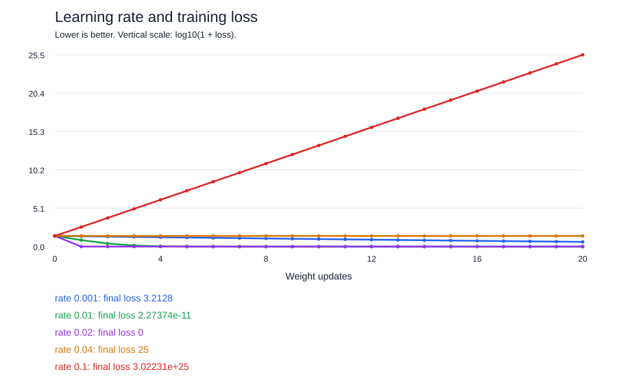

# Learning Rate Playground

A small, dependency-free experiment that shows how learning rate changes gradient descent. Clone it, run it, and compare slow learning, convergence, oscillation, and divergence.



## Quick start

Requires Python 3.9 or newer. No packages, API keys, or datasets are needed.

From this repository's directory:

```sh
python3 playground.py
```

Open `results/comparison.svg` in your browser. Hover over a point to see its loss. `results/measurements.csv` contains every recorded weight, prediction, loss, and gradient.

## The problem

We want one neuron to predict **15** when its input is **5**. It starts with weight **2**, so its first prediction is **10**. There is no bias in this example.

```text
prediction = input * weight
loss       = (prediction - target)^2
gradient   = 2 * (prediction - target) * input
new_weight = weight - learning_rate * gradient
```

The ideal weight is `15 / 5 = 3`. At weight 2, loss is 25 and gradient is -50. A learning rate of 0.01 updates the weight to 2.5 and reduces loss to 6.25. A rate of 0.1 updates it to 7 and increases loss to 400.

The script calculates the derivative explicitly so you can inspect the arithmetic. It does not use automatic differentiation or train a language model.

## What the default experiment shows

| Learning rate | Behaviour for this example |
|---|---|
| 0.001 | Slow convergence |
| 0.01 | Faster convergence |
| 0.02 | Reaches the ideal weight in one update |
| 0.04 | Oscillates between weights 2 and 4 with constant loss |
| 0.1 | Overshoots and diverges |

The chart uses `log10(1 + loss)` to keep divergent runs visible alongside small losses. Its vertical labels are transformed values, not raw losses. Use the CSV for exact measurements. Step 0 is the initial state, before any update.

These rates are specific to this one-sample squared-error problem. They are not recommendations for other models. In exact arithmetic, the error in the weight follows:

```text
next_error = (1 - 2 * learning_rate * input^2) * current_error
```

Convergence requires `0 < learning_rate < 1 / input^2`. For input 5, the upper boundary is 0.04. Floating-point rounding can affect very small errors.

## Try your own experiment

```sh
python3 playground.py --rates 0.005 0.015 0.03 --steps 40
python3 playground.py --x 2 --target 6 --weight 0 --rates 0.01 0.125 0.25
```

Before running the second command, predict which rate will converge in one update and which will oscillate. Then check the chart and CSV.

You can also change the starting weight, increase the number of updates, or compare values just below and above the convergence boundary. Use `--output my-experiment` to keep separate results. Runs stop at the last finite measurement if the numbers overflow, and the summary reports the early stop.

## Check the calculations

```sh
python3 -m unittest discover -s tests -v
```

The checks cover the hand-calculated update, convergence, oscillation, divergence, and invalid inputs.

## Build on it

Possible extensions include adding a bias, training on multiple samples, comparing explicit gradients with PyTorch autograd, or plotting the weight trajectory. Each changes the experiment, so explain the new assumptions and verify the calculations.

For the next learning step, see the official [PyTorch optimization tutorial](https://docs.pytorch.org/tutorials/beginner/basics/optimization_tutorial).

## License

MIT. You may use, modify, and redistribute this project under the terms in [LICENSE](LICENSE).
